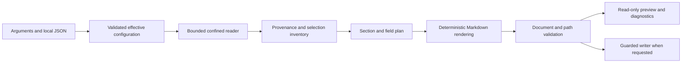

# CLI architecture specification

## Status and delivery boundary

This is the accepted Phase 5 design, not an implemented executable or public API.
No package manifest, lockfile, TypeScript source, installed dependency, or npm release
is created in this phase. Phase 6 implements init/analyze/generate/validate; Phase 7 adds
update/check/doctor and advanced customization. Phase 8 adds executable localization.
Existing Python checkers and example programs remain development fixtures, not the CLI.

## Technology and packaging decision

Use TypeScript in strict mode, compiled to native Node.js ESM with `tsc` and NodeNext
module resolution. Use one npm package and one `craftmentation` bin pointing to
`dist/cli/index.js`, with a Node shebang. No monorepo, bundler, native addon, embedded
Python, runtime transpiler, plugin auto-discovery, or installation hook is needed.

Target the Node 24 and 26 LTS lines at implementation time; verify exact supported
patch floors against resolved dependency engines before recording engines in Phase 6.
The local Phase 5 runtime is Node 20.19.4 and was not upgraded or treated as a supported
CLI test environment. Planned platform coverage is macOS, Linux, and Windows; no CLI
platform compatibility has been tested yet. [ADR 0003](decisions/0003-cli-technology.md)
records alternatives and official sources.

Planned runtime dependencies are Commander, Ajv, unified, remark-parse, remark-gfm,
github-slugger, and parse5. Each has a specific parsing/validation role. Exact compatible
versions and the transitive tree must be inspected and locked during Phase 6; none is
installed here. Use TypeScript and Node type declarations as development dependencies,
Node's built-in test runner, and no separate test framework initially.

Package only compiled code and the required templates, sections, schemas, prompts,
linked framework documentation, README, and license/notices using an explicit allowlist.
Exclude tests, fixture outputs, local files, and the large brand reference board unless
an artifact is explicitly needed. Resolve shipped data from `import.meta.url`, never
from the target working directory. Verify a packed archive before publishing in Phase 11.
An installing user must not need build tools or a postinstall script.

## Planned module boundaries and interfaces

These names are design interfaces; no stable programmatic import API is published yet.
`src/` directories should be created when their implementation becomes necessary.

| Component | Responsibility | Proposed interface |
|---|---|---|
| cli | Parse arguments/help and map diagnostics to output/exit codes | `run(argv, io): Promise<number>` |
| configuration | Load strict JSON, validate, apply explicit defaults and precedence | `resolveConfig(root, options): EffectiveConfig` |
| analyzer | Bounded static inventory, extraction, type signals, provenance | `analyze(root, config, reader): Analysis` |
| generator | Select supported evidence, populate known fields, build a plan | `plan(analysis, config, library): GenerationPlan` |
| renderer | Literal nonrecursive field substitution and Markdown assembly | `render(plan): RenderedDocument` |
| validator | Schema, GFM structure, links, placeholders, and safety diagnostics | `validate(document, context): Diagnostic[]` |
| filesystem | Confined reads, snapshots, staging and guarded writes | `snapshot(path)`, `commit(writePlan)` |
| localization | Language navigation/status and later translation integrity | Reserved boundary; Phase 8 implementation |
| integrations | Optional provider port; no dependency from deterministic pipeline | Reserved boundary; see provider contract below |

No module below cli reads process.argv, prints, calls process.exit, or decides prompts.
Analyzer receives a confined reader; generator/renderer are pure and cannot spawn a
process, write files, or access the network. Only the writer commits requested files.
Validators consume filesystem snapshots through the same confinement policy. Configuration
must not import JavaScript/TypeScript from a target, read arbitrary environment settings,
or let repository metadata register a plugin or command.

## Data flow

Configuration validity is not evidence that its claims are true. Analysis preserves
unknowns and source locations. The generator translates supported facts into catalog
fields; unavailable fields never become placeholders in a published README. Missing Core
or explicitly requested content blocks generation with an evidence diagnostic. Non-Core
auto content is omitted when unsupported. Selection precedence is unchanged from Phase 3.

## Static analysis and provenance

The canonical version-1 model is [analysis.schema.json](../schemas/analysis.schema.json).
Paths are root-relative POSIX strings in serialized data; runtime paths use native path
utilities. Output root is `.` and never leaks an absolute home/workspace path. A sorted
file inventory carries content hashes; a source fingerprint hashes the sorted path/hash
pairs. Exclude timestamps and nondeterministic traversal order from semantic output.

Facts contain an ID, kind, value or null, verified/missing/unknown state, inspected or
maintainer provenance, source path/locator, and safety assessment. The static analyzer
never labels a fact executed. A script declaration only establishes that a script exists.
Dependencies establish technologies, not product features, test success, or compatibility.
Sources that could contain secrets are skipped or redacted before facts/JSON output.
The `safe` field records assessment, not a guarantee of secret detection.

Type detection produces separate detected and selected profile IDs and source signals.
Use deterministic documented signal priority: explicit projectType controls selected;
otherwise strong manifest/workspace evidence outranks source-extension hints. If competing
signals lack a clear primary project, use general and explain ambiguity. An override
changes section recommendations, never manufactures features. Begin Phase 6 with JSON
manifest/README/static asset readers; unsupported formats remain unknown. All fourteen
profiles can be chosen explicitly. Broader ecosystem detection belongs to Phase 7.

Default bounds: 10,000 regular files, depth 20, 1 MiB per text file, and 32 MiB total
text read. Sort before processing; record skipped directories/files, binary content,
symlinks, and truncation. Exclude .git, vendor/generated/dependency directories, credentials,
private keys, and actual .env files. Inspect safe examples only. Reaching a limit emits
`E_SCAN_LIMIT`, makes generation incomplete, and never silently reports full analysis.
These are planned limits, not measured performance claims.

Reuse the library `selectionRequest` shape exactly: profile, include, exclude, evidence,
and customSections. Existing formatVersion-1 catalog/profile files remain unchanged.
The new library schema describes their shape; semantic checks still enforce unique IDs,
known fields, Core protections, source truth, and allowed paths. AI walkthrough JSON
from Phase 4 is explicitly not a CLI analysis document and is not silently migrated.

## Deterministic generation and extension boundaries

Use the existing literal `{{FIELD_NAME}}` vocabulary. Built-in population adapters map
known facts to specific fields; they do not infer missing application behavior from
file names or a profile. Preserve human-provided content attribution. Unsupported automatic
mappings remain unknown. A generated description may cite a manifest description or an
explicitly supplied description; the directory basename alone is not verified identity.
See [ADR 0005](decisions/0005-rendering-validation.md) for Markdown rendering/validation.

GenerationPlan contains selected/omitted/unresolved section IDs and reasons, field values
with source references, ordered fragments, output-relative path, and source fingerprint.
RenderedDocument contains UTF-8 Markdown bytes, document hash, and the same provenance map.
A single-document WritePlan contains destination, absent-or-existing snapshot, expected
old hash when applicable, new bytes/hash, and operation kind. Preview never constructs
credentials or temporary output files. Phase 6 init creates only config and generate
creates only its requested README, keeping commits single-file operations.

Custom templates remain data: local catalog/layout/fragment records using the versioned
library contract, no expressions/includes/helpers or executable configuration. Custom
section IDs use `custom-`, cannot replace Core, and participate in the same evidence gates.
Phase 6 rejects custom templates/sections as unsupported if not implemented; Phase 7
must implement them rather than silently ignore them. Future custom library paths are
root-confined, package namespaces are not dynamically imported, and remote templates are forbidden.

## Optional AI provider port

Core modules cannot import a provider SDK. A future provider receives an explicit
redacted evidence bundle and returns a proposal with source references, diagnostics,
and proposed field values. It cannot request filesystem/process access or write files.
An orchestration layer applies an explicitly configured provider only after user opt-in
and then runs the same deterministic validation/review pipeline. No credentials live in
config; a future integration defines explicit credential lookup and transmission consent.

No provider is shipped or invoked in Phases 5–7. `ai.enabled: true` fails with E_CAPABILITY
until a concrete provider adapter is implemented and authorized; it never falls back to
an implicit vendor. The reserved port covers generation/update/translation proposals;
provider output is untrusted, cannot elevate its own provenance to verified, and cannot
bypass Core, license, path, or secret-safety checks. Human prompts remain available without it.

## Configuration, command, write, and test contracts

- [Configuration](configuration.md) defines schema, defaults, merging, staging, and compatibility.
- [CLI reference design](cli-reference.md) defines commands, flags, exit codes, and JSON output.
- [Safe operations](safe-file-operations.md) defines path confinement, concurrency, and preservation limits.
- [Development/testing plan](development.md) defines implementation and release gates.

There is no universal multi-file transaction or strong defense against an adversary
rewriting parent directories concurrently. The writer requires a quiescent authorized
workspace and fails closed on detected changes. Native filesystem assumptions and race
limits are explicit, not concealed by the word atomic.
